<h1 align="center">Hi, I'm Muhammad Kabir Kaka 👋</h1>
<h3 align="center">Frontend Engineer · React.js · Next.js · TypeScript</h3>

  
  
  

---

### About me

- 💼 Frontend Developer at **Imperium Dynamics**, building enterprise web apps with React and Next.js
- 🚀 **3+ years** of professional experience and **30+ production apps** shipped: enterprise platforms, SaaS products, dashboards, AI platforms and real-time systems
- 🧩 Focused on fast, accessible, maintainable UIs: clean component architecture, solid state management and pixel-accurate implementation of designs
- 🎓 BS Computer Science, NED University Karachi (CGPA 3.77/4.0)
- 📍 Karachi, Pakistan · open to remote roles and freelance projects

### Tech stack

**Core:** React.js · Next.js · TypeScript · JavaScript (ES6+)  
**Styling:** Tailwind CSS · CSS3 / SCSS  
**State & data:** Redux Toolkit · Zustand · GraphQL · REST · WebSockets  
**Backend & tools:** Firebase · Git · Vercel

  

### Experience

| Role | Company | Period |
|---|---|---|
| Frontend Developer | Imperium Dynamics | 03/2026 – Present |
| Frontend Developer | AL-Rafay Consulting | 10/2024 – 02/2026 |
| Frontend Developer | TAFSOL Technologies | 05/2023 – 09/2024 |

### GitHub stats

  
  

---

Most of my client work lives in private repos. Happy to walk through it on a call. <a href="mailto:mohammadkabirkaka@gmail.com">Let's talk</a>.

